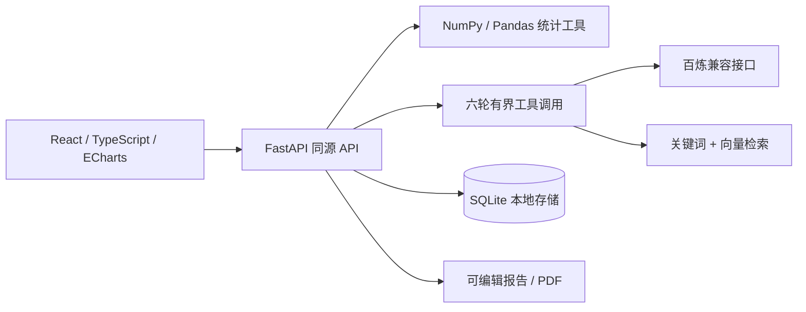

# 桥安智析 · Bridge Insight

面向桥梁监测分析人员的本地 AI 分析工作台。通过**数据导入 → 温度补偿 → 异常证据 → 资料检索 → 可编辑报告**形成可复核流程。

## 当前交付状态

- 已实现并验证：三类模拟案例、CSV 校验、可选健康参考区间、统计分析、图表联动、资料导入与关键词检索、报告保存与 PDF 导出、响应式四页面。
- 已实现并经离线协议测试：真实模型 SSE 接入、六轮受限 Function Calling、会话存储、超时与取消处理、混合检索及向量缓存。
- **尚未完成真实模型验收**：用户计划稍后配置百炼密钥。离线测试不证明真实 API 调用成功。未配置时明确报错，不生成预设答案。
- 演示案例均为模拟数据，不是 Z24 原始数据，不代表真实工程验证。异常不等同于损伤，系统不输出法定安全等级。

## 安装与启动

环境：Windows 10/11、Python 3.11+、Node.js 20.19+ 或 22.12+、npm、Git。首次安装需要联网。

1. 双击 `安装依赖.bat`，等待窗口显示 `Setup complete` 后按任意键关闭。也可以运行 `powershell -File scripts/setup.ps1`。
2. 双击 `启动平台.bat`。页面可访问后会自动打开默认浏览器，已有平台在运行时会直接打开现有页面。若浏览器未打开，可手动访问 http://127.0.0.1:8000/ 。启动服务的窗口应保持打开。
3. 选择案例，确认健康参考区间，点击“运行统计分析”。

安装或启动失败时，批处理窗口会保留错误提示。若提示 8000 被其他服务占用，可以运行 `powershell -ExecutionPolicy Bypass -File scripts/start.ps1 -Port 8001`，访问 http://127.0.0.1:8001/ 。

手动安装：

```powershell
python -m venv --without-pip .venv
python -m pip --python .venv install -r requirements.lock.txt
cd frontend
npm ci
npm run build
cd ..
.\.venv\Scripts\python.exe -m scripts.launch
```

前端开发：在 `frontend` 运行 `npm run dev`；后端仍用 8000 端口。生产构建的前端由 FastAPI 同源提供，无外部图表 CDN。

## 真实模型配置

将 `.env.example` 复制为 `.env`，仅在本机编辑：

```dotenv
AI_API_KEY=填入自己的百炼密钥
AI_BASE_URL=https://dashscope.aliyuncs.com/compatible-mode/v1
AI_MODEL=qwen-plus
EMBEDDING_MODEL=text-embedding-v2
```

根据百炼账号地域和业务空间使用其控制台对应的兼容接口地址。`.env`、运行数据和上传文件均在 `.gitignore` 中。不要把密钥放进前端、截图或 Git。

重启后前端应显示“已配置”。在项目根目录运行 `.\.venv\Scripts\python.exe scripts\verify_live_ai.py`，使用你的 API 额度验证工具调用、向量检索和引用。模型用量和耗时随会话保存。数值计算在本机完成，模型服务接收工具摘要、问题和检索片段。启用向量检索时，资料片段也会发送到配置的模型服务，请使用你有权发送的资料。

## 数据格式

CSV 使用 UTF-8 编码，逗号分隔，每日一条数据：

```csv
date,temperature,f1,f2,f3,f4,damage
2025-01-01,12.3,3.91,4.96,9.81,10.86,0
```

- 必填 `date,temperature,f1,f2,f3,f4`；温度单位 °C，频率单位 Hz。
- `damage` 为可选 0/1 评估标签，绝不参与拟合、阈值或预测。
- 30–20000 条记录、最大 10 MB；缺列、缺失、非数值、无限值、无效日期、重复日期和非正频率均返回具体提示。
- 日期会排序，但不静默插值或填补。健康参考区间至少 30 点、温差至少 1°C；需要用户根据专业记录确认。

## 架构与目录



- `frontend/src`：四页面工作台、图表组件、类型及接口客户端。
- `backend`：统计计算、存储、资料检索、Agent、API、PDF 渲染。
- `tests`：分析正确性、接口、数据异常和离线 AI 协议测试。
- `scripts`：安装启动、真实模型验收、技术材料生成。
- `runtime`：自动生成的本地数据库、上传 CSV、缓存；不进入 Git。
- `output`：生成的 PDF、测试报告和界面截图。提交时单独选取所需文件。

## 关键接口

| 方法与路径 | 功能 |
|---|---|
| GET /api/status | 配置状态，不泄露密钥 |
| GET/POST /api/datasets | 案例列表 / CSV 导入 |
| POST /api/analyses | 输入 dataset_id、start、end，保存不可变分析快照 |
| GET/POST /api/documents | 文本资料列表 / 导入 |
| GET /api/search?q=… | 附来源的检索结果与当前检索模式 |
| POST /api/chat | analysis_id、question、可选 conversation_id；SSE 流 |
| GET /api/conversations?analysis_id=… | 当前分析的历史会话 |
| GET/POST /api/reports | 报告列表 / 从分析快照生成 |
| PATCH /api/reports/{id} | 编辑 conclusion |
| GET /api/reports/{id}/pdf | 导出已保存版本 |

完整字段见 http://127.0.0.1:8000/docs 。SSE 事件：conversation、status、token、tool、citations、done、error。

## 测试与可复现性

```powershell
.\.venv\Scripts\python.exe -m pytest -q --junitxml=output/test-results.xml
cd frontend
npm run build
```

29 项自动化测试已通过。详细结果和浏览器验证见 `docs/验收记录.md`。模拟数据固定随机种子 20261115，误报与漏报指标只评价参考区间之后的样本。依赖锁定文件为 `requirements.lock.txt` 和 `frontend/package-lock.json`。

## 比赛材料与未完成事项

按 2026-11-18 提交准备；官网时间文字有矛盾，最终以个人中心/组委会通知为准。

- 技术文档：`output/pdf/桥安智析_技术文档.pdf`。
- 统计报告示例：`output/pdf/桥安智析_分析报告示例.pdf`。
- 演示视频由团队另行准备。赛道要求为 5–8 分钟、至少 1080p 的普通话 MP4。
- 团队信息：学校【待填】、参赛组别【待填】、成员【待填】、指导老师【待填】。
- Git 历史如实记录本次开发；自动化提交作者 Codex，不冒充参赛者。尚未创建远程仓库、发布公网或向比赛官网提交。
- 本地 Git 历史归档在 `output/桥安智析_源码与提交历史.bundle`。可运行 `git clone "output/桥安智析_源码与提交历史.bundle" bridge-insight` 恢复完整源码及提交记录。使用参赛者账号将本地仓库推送到 GitHub 或 Gitee，并按赛道规则设置评审访问权限。

## 参考来源

- 比赛官网：https://www.boxuegu.com/matchTrack/detail/?id=10037
- Qwen Plus：https://help.aliyun.com/zh/model-studio/qwen-plus
- Function Calling：https://help.aliyun.com/zh/model-studio/qwen-function-calling
- Embedding：https://help.aliyun.com/zh/model-studio/embedding-interfaces-compatible-with-openai
- FHWA Bridge Preservation Guide：https://www.fhwa.dot.gov/bridge/preservation/guide/guide.pdf

内置 FHWA 条目为项目编写的短导读，不是完整原文语料；明确标注国外参考，不用作中国规范。
